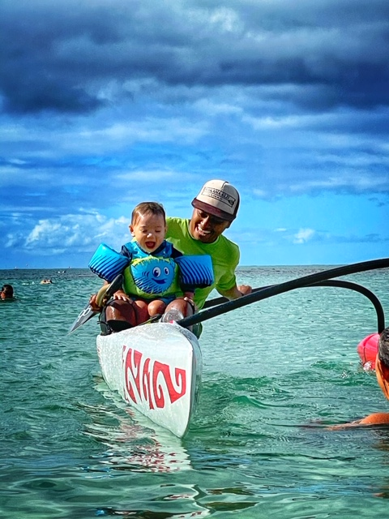

## Esther Widiasih

Mathematician at the University of Hawaiʻi West Oʻahu. I build dynamical systems models that give structure to data, and I work with the people who know the systems best.

## What I work on

Conceptual climate models. Energy balance models, ice-line dynamics, glacial cycles and nonsmooth systems, including the Budyko–Widiasih model.
Hawaiian fishponds. Dissolved-oxygen models driven by light, wind and tide, built with community partners and tested on long sensor records.
Resilience to recurring disturbance. Flow-kick dynamics for restoration work in tidally driven systems.
Teaching modeling with AI. Predict, verify, validate, disclose: students learn to check AI-written code against what must be true. 

And sometimes, not very often, I paddle.

## How I work

The math and the people it involves are one process.
Community partners' knowledge comes first, and data governance is written down, not assumed.
A good model can fail against the data, and it also gives the data a story: it turns measurements into an understanding of how the system works.

## Find me

* [Faculty profile](https://westoahu.hawaii.edu/facultyprofiles/user/widiasih)
* https://estherwidi.github.io/
